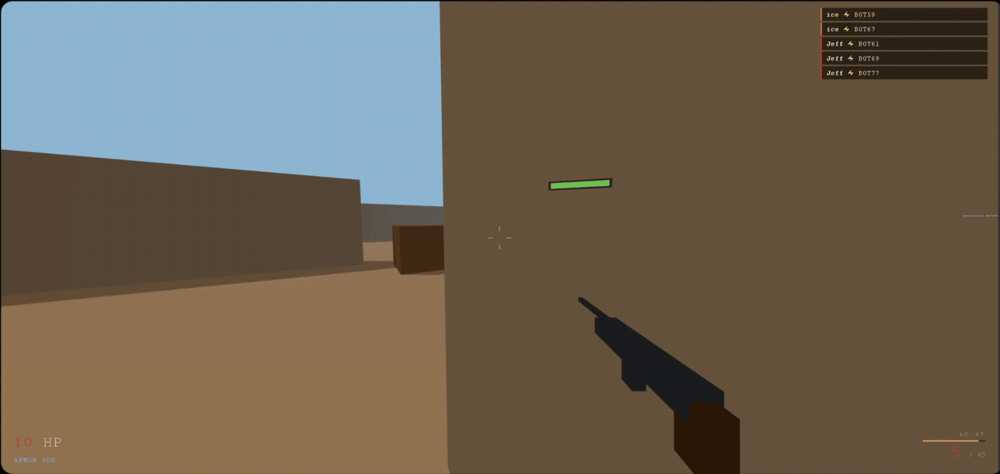

<div align="center">



# FragZone — Browser FPS

**CS:Source-inspired online FPS. Free-for-all deathmatch, up to 8 players.**

Three.js · WebSockets · no install, no plugins — just a browser.

</div>

---

## Controls

| Key | Action |
|-----|--------|
| WASD | Move |
| Mouse | Aim |
| LMB | Shoot |
| Shift | Walk (quiet) |
| Space | Jump |
| Ctrl | Crouch |
| G | Throw grenade |
| R | Reload |
| 1 / 2 | Switch weapon |
| Tab | Scoreboard |

## Local Dev

**Terminal 1 — game server:**
```bash
cd server
npm install
npm run dev
```

**Terminal 2 — client:**
```bash
cd client
npm install
npm run dev
# open http://localhost:3000
```

## Deploy

### Server → Railway
1. Push `server/` to a GitHub repo (or connect whole monorepo)
2. New Railway project → deploy from GitHub
3. Railway auto-detects Node.js, uses `npm start`
4. Copy the Railway URL (e.g. `fragzone-server.railway.app`)

### Client → Vercel
1. Import `client/` folder (or root) to Vercel
2. Set environment variable: `VITE_WS_URL=wss://fragzone-server.railway.app`
3. Deploy

## Stack

- **Client**: Vite + Three.js (vanilla JS, no framework)
- **Server**: Node.js + ws (WebSocket)
- **Deploy**: Vercel (client) + Railway (server)
